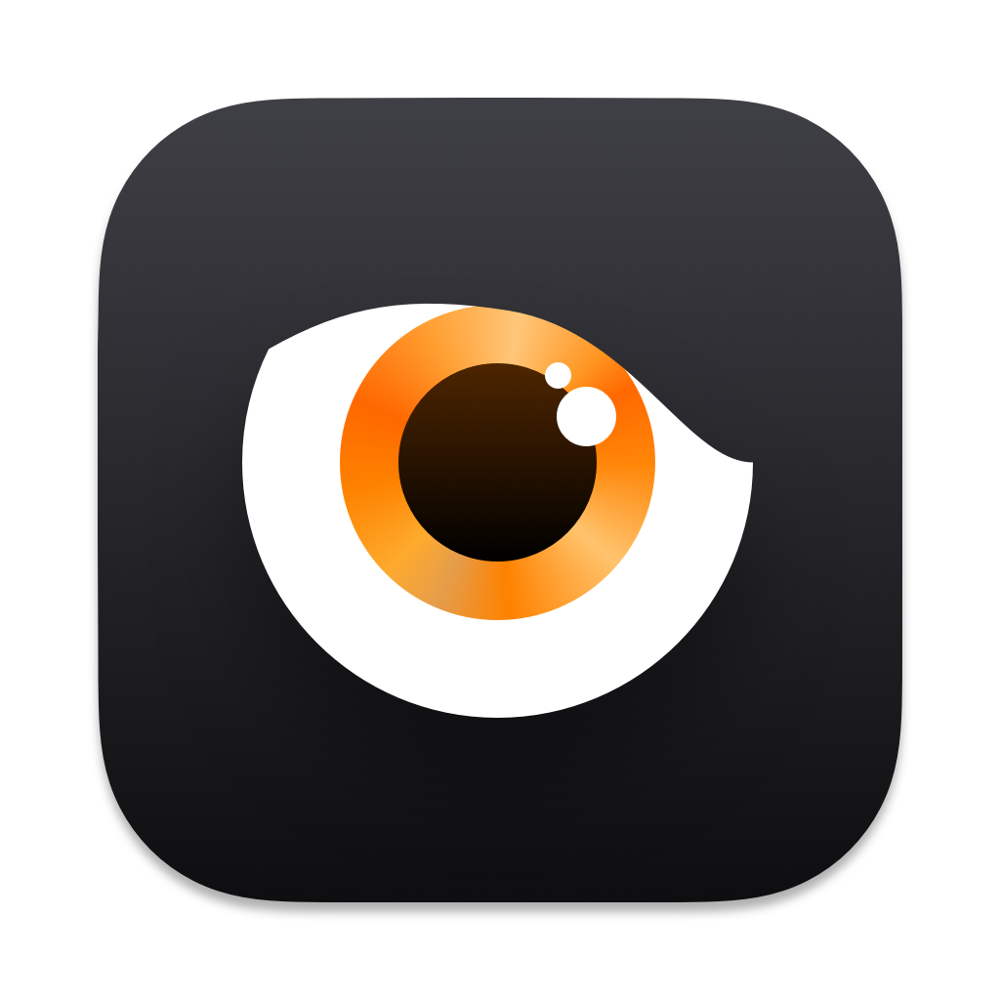
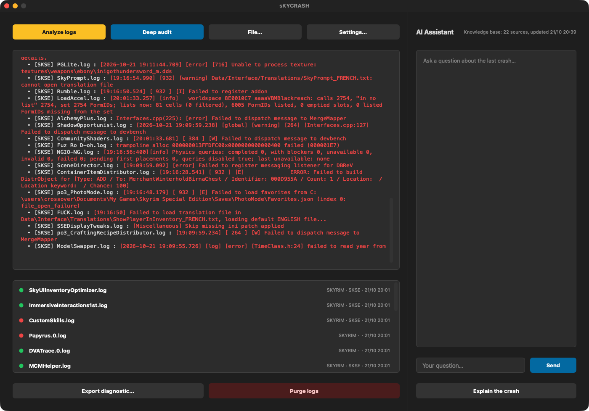

<p align="center"></p>

# sKYCRASH

**Crash log analyzer for Skyrim Special Edition on Mac (CrossOver / Whisky).**  
*Analyseur de crash logs pour Skyrim Special Edition sur Mac (CrossOver / Whisky).*

🇬🇧 [English](#-english) · 🇫🇷 [Français](#-français)

---
## 🇬🇧 English

### What it does

sKYCRASH reads your Skyrim crash reports (Crash Logger SSE, .NET Script Framework), SKSE and Papyrus logs, cross-checks them with your actual installation and your last save, and tells you which DLL, plugin, mesh or script is most likely responsible — with the evidence. An optional AI assistant answers your questions about the crash.

### Features

- **Analyze logs**: quick scan of all configured log folders (the SKSE folder is always included).
- **Deep audit**: rule engine that ranks suspects (DLLs, plugins, scripts) by category — memory, graphics, meshes, animations, saves…
- **Verified installation sheet**: SkyrimSE.exe version, matching Address Library, SKSE DLLs, plugins.txt, Creation Club content, 254 full-plugin limit.
- **Save comparison**: reads your last `.ess` save and lists plugins added or removed since — a classic cause of crashes on load.
- **Crash timeline and history**: DLLs that appeared just before a new kind of crash are flagged as prime suspects.
- **AI assistant** (optional): local and private with Ollama, or Google Gemini with your own key. Answers are checked against your real installation and contradicting tips are removed.
- **Self-updating knowledge base**: follows Crash Logger, Community Shaders, Steam updates, r/skyrimmods, SKSE and CrossOver release notes.
- **Export diagnostic** (⌘E): one file with the whole crash context, ready to share on a forum or Discord.
- **Purge logs**: archives old crash reports so the next crash is easy to spot.
- Interface in **English, French, Italian and Spanish** (follows your Mac's language; can be changed in the app).

### Screenshots


*Analyzed logs, log list and AI assistant*

### Requirements

A Mac with **Apple Silicon** (M1 or later), **macOS 13 Ventura** or later. No Python, no Wine, no virtual machine needed.

### Installation

1. Download the zip from Nexus Mods (or from the GitHub releases) and unzip it.
2. Move **sKYCRASH.app** to your **Applications** folder.
3. First launch: the app is signed with a personal certificate but **not notarized by Apple**, so macOS blocks it. Open **System Settings → Privacy & Security**, scroll down and click **Open Anyway** next to sKYCRASH, then confirm. On macOS 14 or earlier you can also right-click the app → **Open** → **Open**.
4. Still blocked? In Terminal: `xattr -dr com.apple.quarantine /Applications/sKYCRASH.app`

### How to use

1. Install **Crash Logger SSE** (or .NET Script Framework) in your game so that crash reports are written.
2. Open sKYCRASH → **Settings…**: check the game folder (detected automatically under CrossOver) and the log folders.
3. After a crash, click **Analyze logs** for a quick look, then **Deep audit** for the ranked suspects and evidence.
4. Click a log in the list to read it; ask the **AI assistant** a question, or click **Explain the crash**.
5. Fix, test, then **Purge logs** before your next session.

### FAQ

**No crash log is found.**  
Crash Logger SSE must be installed and SKSE must start. Check the log folders in Settings… > Log folders.

**Do I need an AI?**  
No. The analysis, audit and evidence work offline without any AI. The assistant is an extra.

**Which AI should I choose?**  
Ollama is 100% local and private (`ollama pull llama3.1`). Gemini gives better answers but sends the report and log excerpts to Google.

### Privacy

Logs stay on your Mac. Network access is used only for the knowledge base updates (public pages from GitHub, Steam, Reddit, SKSE and CodeWeavers, HTTPS only, no account) and, if you enable it, for the Gemini AI assistant. API keys are stored in the macOS Keychain.

### Building from source

Requires Python 3.12 with PyQt6 and PyInstaller. From the repository folder:

```bash
./Build_App.sh
```

### License

Released under the **MIT License**: free to use, modify and share. Part of the **Skyrim Mac Toolkit**, a set of modding tools built for Skyrim players on Mac.

---

## 🇫🇷 Français

### À quoi ça sert

sKYCRASH lit vos rapports de crash Skyrim (Crash Logger SSE, .NET Script Framework), vos logs SKSE et Papyrus, les recoupe avec votre installation réelle et votre dernière sauvegarde, et vous indique quelle DLL, quel plugin, mesh ou script est le plus probablement en cause — preuves à l'appui. Un assistant IA facultatif répond à vos questions sur le crash.

### Fonctions

- **Analyser les logs** : scan rapide de tous les dossiers de logs configurés (le dossier SKSE est toujours inclus).
- **Audit approfondi** : moteur à règles qui classe les suspects (DLL, plugins, scripts) par catégorie — mémoire, graphismes, meshes, animations, sauvegardes…
- **Fiche d'installation vérifiée** : version de SkyrimSE.exe, Address Library correspondante, DLL SKSE, plugins.txt, contenu Creation Club, limite de 254 plugins complets.
- **Comparaison avec la sauvegarde** : lit votre dernière sauvegarde `.ess` et liste les plugins ajoutés ou retirés depuis — une cause classique de crash au chargement.
- **Chronologie et historique des crashs** : une DLL apparue juste avant un nouveau type de crash est signalée comme suspect principal.
- **Assistant IA** (facultatif) : local et privé avec Ollama, ou Google Gemini avec votre propre clé. Les réponses sont vérifiées face à votre installation réelle et les conseils contradictoires retirés.
- **Base de connaissances auto-alimentée** : suit Crash Logger, Community Shaders, les mises à jour Steam, r/skyrimmods, SKSE et les notes de version de CrossOver.
- **Exporter le diagnostic** (⌘E) : un seul fichier avec tout le contexte du crash, prêt à partager sur un forum ou Discord.
- **Purger les logs** : archive les anciens rapports pour repérer facilement le prochain crash.
- Interface en **français, anglais, italien et espagnol** (suit la langue du Mac ; modifiable dans l'appli).

### Captures d'écran


*Logs analysés, liste des logs et assistant IA*

### Configuration requise

Un Mac **Apple Silicon** (M1 ou plus récent), **macOS 13 Ventura** ou plus récent. Ni Python, ni Wine, ni machine virtuelle.

### Installation

1. Téléchargez le zip sur Nexus Mods (ou dans les releases GitHub) et décompressez-le.
2. Placez **sKYCRASH.app** dans votre dossier **Applications**.
3. Premier lancement : l'appli est signée avec un certificat personnel mais **pas notarisée par Apple**, macOS la bloque donc. Ouvrez **Réglages Système → Confidentialité et sécurité**, descendez et cliquez sur **Ouvrir quand même** à côté de sKYCRASH, puis confirmez. Sous macOS 14 ou antérieur, vous pouvez aussi faire clic droit sur l'appli → **Ouvrir** → **Ouvrir**.
4. Toujours bloquée ? Dans le Terminal : `xattr -dr com.apple.quarantine /Applications/sKYCRASH.app`

### Utilisation

1. Installez **Crash Logger SSE** (ou .NET Script Framework) dans le jeu pour que les rapports de crash soient écrits.
2. Ouvrez sKYCRASH → **Réglages…** : vérifiez le dossier du jeu (détecté automatiquement sous CrossOver) et les dossiers de logs.
3. Après un crash, cliquez sur **Analyser les logs** pour un aperçu, puis **Audit approfondi** pour les suspects classés et les preuves.
4. Cliquez sur un log de la liste pour le lire ; posez une question à l'**assistant IA**, ou cliquez sur **Expliquer le crash**.
5. Corrigez, testez, puis **Purgez les logs** avant la session suivante.

### Questions fréquentes

**Aucun crash log n'est trouvé.**  
Crash Logger SSE doit être installé et SKSE doit démarrer. Vérifiez les dossiers de logs dans Réglages… > Dossiers de logs.

**Faut-il une IA ?**  
Non. L'analyse, l'audit et les preuves fonctionnent hors ligne sans IA. L'assistant est un plus.

**Quelle IA choisir ?**  
Ollama est 100 % local et privé (`ollama pull llama3.1`). Gemini répond mieux mais envoie le rapport et des extraits de logs à Google.

### Confidentialité

Les logs restent sur votre Mac. Le réseau ne sert qu'à mettre à jour la base de connaissances (pages publiques de GitHub, Steam, Reddit, SKSE et CodeWeavers, HTTPS uniquement, sans compte) et, si vous l'activez, à l'assistant IA Gemini. Les clés API sont rangées dans le Trousseau macOS.

### Compiler depuis les sources

Nécessite Python 3.12 avec PyQt6 et PyInstaller. Depuis le dossier du dépôt :

```bash
./Build_App.sh
```

### Licence

Publié sous **licence MIT** : libre d'utilisation, de modification et de partage. Fait partie du **Skyrim Mac Toolkit**, un ensemble d'outils de modding pensés pour les joueurs de Skyrim sur Mac.
